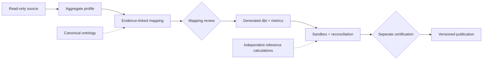

# Portfolio Company Data Onboarding Agent

One company records invoice lines in cents and invoice headers in dollars. Another calls a CRM
opportunity column `rev`, although it represents potential bookings, not recognized revenue.
A plausible column match can quietly turn either into the wrong financial report.

This system profiles sources, proposes evidence-linked mappings to a private-equity reporting
model, generates dbt and semantic definitions, and reconciles the results before a separate
reviewer can certify publication.

**Scope:** an AI-assisted portfolio prototype with synthetic financial workflows, typed CSV and
read-only PostgreSQL snapshots, and local publication; no production customers or measured savings.

[](https://github.com/ahines99/portco-data-onboarding/actions/workflows/ci.yml)

**[Project page and replay](https://ahines99.github.io/portco-data-onboarding/)** ·
[Case study](docs/portfolio_case_study.md) · [Architecture](docs/architecture.md) ·
[Evaluation and limitations](docs/EVALUATION.md) · [Release status](docs/RELEASE-STATUS.md)

## Run the demo

Requires Python 3.12 and [uv](https://docs.astral.sh/uv/). The demo needs no Docker or API keys.

```bash
uv sync --all-extras --frozen
uv run poe demo
```

The synthetic SaaS fixture catches both traps, denies agent self-approval, and publishes nine
reconciled metrics after scripted reviewer decisions. The other paths demonstrate malformed
source data, a retried timeout and an instruction planted in a table comment.

<!-- demo-output:start -->
```text
== 1. Success path: fixture A (synthetic B2B SaaS company)
   agent profiled, inferred entities/joins and proposed mappings -> paused at 'mapping_review' with 28 review items
   trap caught -> billing.invoice_lines.amount -> invoice_line.amount (suggest cents_to_major) [UNIT_MISMATCH]
   trap caught -> crm.opportunities.rev -> opportunity.amount [LOW_CONFIDENCE, SEMANTIC_TRAP]
   agent tried to approve its own proposals -> Forbidden
   generated dbt + semantic layer; sandbox build exit 0; 27/27 reconciliation checks passed (money exact to the cent)
```
<!-- demo-output:end -->

See the [recorded replay](https://ahines99.github.io/portco-data-onboarding/#demo) and
[full transcript](docs/evidence/demo-transcript.txt). Reviewers in this demo are automated test identities. Diagnostic logs are saved beside the reports
in `var/demo/diagnostics.log`; use `uv run portco demo --verbose` to show them.

## How it works



The workflow is available through a CLI and typed MCP capabilities. An agent can discover and
propose; deterministic code calculates; reviewer principals decide. Database state records every
step, finding, approval and audit event so a conversation is never the source of truth.

| Control | What it enforces |
|---|---|
| Explicit source contracts | Profiling exposes aggregates and approved category domains. Units, financial classifications and relationships require evidence. |
| Review gates | Ambiguous, metric-bearing, PII and unit-mismatched proposals require review. Unsupported metrics remain `NEEDS_EVIDENCE`. |
| Bound approvals | A reviewer approves a specific content hash. Changes, revocation and expiry invalidate authority; the run starter cannot approve its own run. |
| Independent reconciliation | Generated metrics execute in a disposable sandbox and are compared with Python reference calculations, with monetary values exact to the cent. |
| Recoverable publication | Execution leases fence stale workers; publication verifies the certified files and recovers across filesystem/database failure windows. |

[Architecture and design decisions](docs/architecture.md) explain the implementation and its trust boundaries.

## What the October audit changed

A ten-agent audit found **23 numbered findings**, including a case where `account_type='Revenue'`
turned a 100.00 credit into **0.00 recognized revenue while every check passed**. The SQL and Python
calculators agreed because both assumed lowercase canonical categories. Independent arithmetic
had not provided an independent check of accounting meaning.

The remediation makes financial categories executable contracts: unknown or null classifications
block affected metrics, and case normalization requires a reviewed transform. It also repairs
rejected relationships resurfacing in generated SQL, cached steps bypassing revoked approvals,
and stale-worker publication. The [remediation record](docs/REMEDIATION-2026-10-11.md) maps the
findings to fixes and regression coverage, including tests that reproduce the financial failure
through actual dbt execution. The [original audit and probes](docs/AUDIT-2026-10-10.md) remain available.

Passing a fixture suite was not enough to catch those boundary failures. The
[release status](docs/RELEASE-STATUS.md) identifies which revision and checks verify the repairs.

## My role

I wanted to explore how AI-assisted data onboarding can remain auditable when financial
definitions, source schemas and units disagree. I chose the portfolio direction, reviewed
recommendations and decided which capabilities to pursue. I used AI coding tools extensively
for implementation, tests, audits and documentation. I present the resulting prototype with
its evidence and failures visible, and distinguish automated review from independent human validation.

## Develop and operate

```bash
uv run poe fixtures       # synthetic source databases
uv run poe test           # general suite; PostgreSQL tests run separately
uv run poe eval           # pinned golden evaluation cases
uv run poe cov-metrics    # reference-calculator branch coverage
uv run poe lint
uv run poe typecheck
```

If `uv` is installed as a Python module but unavailable on PATH, use `python -m uv`.

For a manual run, export the review packet, record decisions as a separate reviewer, then resume:

```bash
uv run portco run --fixture portco_a
uv run portco review <run_id> --export review.yaml
uv run portco review <run_id> --import review.yaml --reviewer alice --default approve
uv run portco resume <run_id>
```

The blanket approval flag above is for the supported synthetic walkthrough. Inspect and edit
individual decisions for other inputs. Certification is a separate gate before publication;
the [agent walkthrough](docs/agent_walkthrough.md) and [operations guide](docs/operations.md)
cover the complete workflow, MCP setup, identity, recovery and deployment configuration.
Source contracts: [CSV](docs/CSV-SOURCE.md) · [PostgreSQL](docs/POSTGRES-SOURCE.md).

## Evaluation and limits

Supported-fixture results demonstrate the workflow and its checks. Unfamiliar-schema experiments
also preserve failed safety gates, wrong proposals and substantial review effort. The original
probe matched **0/10** targets; later remediation on a frozen corpus is feedback-informed,
not fresh held-out validation. [Evaluation and limitations](docs/EVALUATION.md) brings the
results, denominators and evidence boundaries together.

The financial demonstration uses synthetic data. A real historical retail exercise proves
bounded ingestion/profiling only. There is no accepted live backend, warehouse publication,
independent human usability study or measured business impact. The optional LLM judge defaults
off; the local semantic executor supports a bounded subset rather than full MetricFlow compatibility.
The project runs locally with a free GitHub Pages presentation; paid hosting remains optional.

[Release status](docs/RELEASE-STATUS.md) is the source for version-specific verification.
[Documentation](docs/README.md) gives the reading path and operator references;
[the archive](docs/archive/README.md) retains historical planning and acceptance records.
